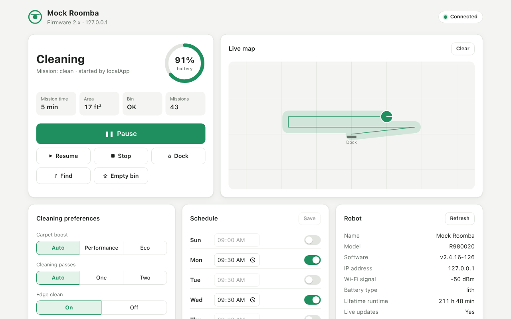

<div align="center">

# dorita980

**Control your Wi‑Fi Roomba from JavaScript, a REST API or your browser, straight over your LAN.**

[](https://www.npmjs.com/package/dorita980)
[](https://github.com/crutchcrew/dorita/actions/workflows/ci.yml)
[](LICENSE)
[](https://bun.sh)



</div>

dorita980 is an unofficial SDK for iRobot Roomba robots (Combo 10 Max, j7, i7/i7+, 980, 960, e5, 690, 675 and more). It talks to your robot directly on your local network, so you can plug it into your own home automation or IoT project. It comes in three parts:

- **A JavaScript library**: start, stop and dock the robot, read its state, change cleaning preferences and schedules, clean specific rooms, and stream live mission data.
- **A REST API and web UI** (formerly the separate [rest980](https://github.com/koalazak/rest980) project): control the robot from any browser or HTTP client on your network.
- **Command-line tools** that fetch your robot's BLID and password.

> [!WARNING]
> **Firmware updates can break dorita980.** If it works for you, consider blocking your robot's internet access (for example with your router's parental controls) so it can't install over-the-air updates. When iRobot publishes a new firmware, check here that dorita980 still works before you let the robot update.

## Contents

- [Compatibility](#compatibility)
- [Getting started](#getting-started)
- [Getting your BLID and password](#getting-your-blid-and-password)
- [REST API and web UI](#rest-api-and-web-ui)
- [Library API](#library-api)
- [Development](#development)
- [Support the project](#support-the-project)

## Compatibility

### Robots

dorita980 speaks the local MQTT‑over‑TLS protocol used by Wi‑Fi Roombas. Known working families:

- Roomba 600, 800 and 900 series (675, 690, 960, 980, …)
- Roomba e, i and j series (e5, i7/i7+, j7, …)
- Braava m6
- Roomba Combo 10 Max

Robots on the newer **v4 protocol** (Matter‑first models such as the Combo Max 705) are **not supported yet**; work on them is in progress.

Not sure which firmware your robot runs? [Check your robot version](http://homesupport.irobot.com/app/answers/detail/a_id/529). On firmware 1.6.x, see the [1.6.x documentation](READMEv1.6.6.md).

### Features by firmware

| Feature                                                   | 1.6.x Local | 1.6.x Cloud | 2.x Local | 2.x Cloud | 3.x Local |
| --------------------------------------------------------- | :---------: | :---------: | :-------: | :-------: | :-------: |
| Clean, start, stop, pause, dock, resume, room clean, find | ✅ | ✅ | ✅ | ⏳ | ✅ |
| Get and set preferences                                   | ✅ | ✅ | ✅ | ⏳ | ✅ |
| Get x, y, θ position                                      | ✅ | ✅ | ✅ | ⏳ | — |
| Get mission                                               | ✅ | ✅ | ✅ | ⏳ | ✅ |
| Get mission number                                        | ❌ | ❌ | ✅ | ⏳ | ✅ |
| Get general info                                          | ✅ | ✅ | ✅ | ⏳ | ✅ |
| Get and set schedule                                      | ✅ | ✅ | ✅ | ⏳ | ✅ |
| Carpet Boost (performance, eco, auto)                     | ✅ | ✅ | ✅ | ⏳ | — |
| Edge Clean                                                | ✅ | ✅ | ✅ | ⏳ | — |
| Cleaning passes (auto, one, two)                          | ✅ | ✅ | ✅ | ⏳ | — |
| Always Finish                                             | ✅ | ✅ | ✅ | ⏳ | — |
| Custom MQTT events                                        | — | — | ✅ | ⏳ | ✅ |
| HTTP API                                                  | ✅ | ✅ | — | — | — |
| Robot IP discovery                                        | ✅ | — | ✅ | — | ✅ |
| Get BLID and password                                     | ✅ | — | ✅ | — | ✅ |
| Several clients at once                                   | ✅ | ✅ | ❌ | ⏳ | ❌ |

✅ supported · ❌ not supported · ⏳ pending · — not applicable

Some newer firmwares don't report the robot's position (the `pose` property) on the local network.

The cloud API isn't implemented for firmware 2.x and later yet. [Help wanted!](https://github.com/koalazak/dorita980/issues/25)

### Runtime and TLS

dorita980 is developed and tested on [Bun](https://bun.sh) 1.2.21 or later. The library and the REST server also run on Node.js 18 or later.

By default dorita980 asks for the `AES128-SHA256` cipher, which some older robots need (for example 900 series robots on firmware 2.x). Bun is built on BoringSSL, which doesn't support that cipher, so on Bun it is dropped and the runtime's default ciphers are used instead. **If the TLS handshake with your robot fails under Bun, run the same code with Node.js**, for example `node ./bin/rest980.js`. The REST server prints a hint in its logs and in the web UI when this looks like the cause.

Newer OpenSSL versions also disable legacy TLS renegotiation, which some robots need. dorita980 turns it back on when it's available. Two environment variables change this behaviour:

| Variable           | Effect                                                                                                                                         |
| ------------------ | ---------------------------------------------------------------------------------------------------------------------------------------------- |
| `ROBOT_TLS_LEGACY` | Set to `0` to turn legacy renegotiation off.                                                                                                   |
| `ROBOT_CIPHERS`    | A custom cipher list for the robot connection, e.g. `ROBOT_CIPHERS=AES128-SHA bun myapp.js`. The runtime ignores any cipher it doesn't support. |

## Getting started

### 1. Install

Install [Bun](https://bun.sh), then add the library to your project:

```bash
bun add dorita980
```

### 2. Get your robot's credentials

Every request needs your robot's **BLID** (its username) and **password**. Follow [Getting your BLID and password](#getting-your-blid-and-password) to get them.

### 3. Send your first command

Create `myapp.js`:

```javascript
const dorita980 = require('dorita980');

const robot = new dorita980.Local('MyBlid', 'MyPassword', '192.168.1.104'); // your robot's IP address

robot.on('connect', async () => {
  try {
    await robot.clean();
  } catch (err) {
    console.error(err);
  } finally {
    robot.end(); // free the connection for the official app
  }
});
```

And run it:

```bash
bun myapp.js
```

> [!NOTE]
> The robot accepts **one local connection at a time**. While dorita980 is connected, the official iRobot app can only reach the robot through the cloud. Call `end()` when you're done.

A couple more examples:

```javascript
// Pause the robot
robot.on('connect', async () => {
  await robot.pause();
  robot.end();
});

// Read the weekly schedule
robot.on('connect', async () => {
  console.log(await robot.getWeek());
  robot.end();
});
```

## Getting your BLID and password

Sign in with your iRobot account email and password. dorita980 asks the iRobot cloud for every robot on the account and prints each one's BLID and password.

Pick whichever is easiest:

```bash
# With bunx (no install)
bunx --package dorita980 get-roomba-password-cloud <iRobot email> <iRobot password> [API key]

# From a clone of this repo
git clone https://github.com/crutchcrew/dorita.git && cd dorita
bun install
bun run get-password-cloud <iRobot email> <iRobot password> [API key]

# With Docker
docker run -it oven/bun bunx --package dorita980 get-roomba-password-cloud <iRobot email> <iRobot password> [API key]
```

Example output:

```
Found 1 robot(s)!
Robot "Dorita" (sku: R98---- SoftwareVer: v2.4.16-126):
BLID=> xxxxxxxxxxxxx
Password=> :1:1486937829:gktkDoYpWaDxCfGh <= Yes, all this string.

Use this credentials in dorita980 lib :)
```

The password is the **whole** string, including the `:1:` prefix.

If the iRobot endpoints change, or you're in another region, you can override them:

| Variable               | Description                                                          |
| ---------------------- | -------------------------------------------------------------------- |
| `GIGYA_API_KEY`        | Gigya API key (same as the optional `[API key]` argument).           |
| `GIGYA_BASE`           | Gigya base URL, e.g. `https://accounts.us1.gigya.com`.               |
| `IROBOT_HTTP_BASE`     | iRobot HTTP base URL, e.g. `https://unauth2.prod.iot.irobotapi.com`. |
| `IROBOT_COUNTRY_CODE`  | Country code used for endpoint discovery. Default `US`.              |
| `IROBOT_DISCOVERY_URL` | Replaces the discovery URL entirely.                                 |

<details>
<summary><b>Older firmwares: get the password from the robot itself</b></summary>

<br>

This method doesn't work on recent firmwares. If it fails, use the cloud method above.

You need the robot's IP address: look it up in your router, scan your network with `nmap`, or use [`dorita980.getRobotIP()`](#finding-your-robot-on-the-network).

```bash
# With bunx
bunx --package dorita980 get-roomba-password <robotIP>

# From a clone of this repo
bun run getpassword <robotIP>

# With Docker
docker run -it --network host oven/bun bunx --package dorita980 get-roomba-password <robotIP>
```

Make sure the robot is on its Home Base and powered on. When the tool asks, press and hold the robot's **HOME** button until it plays a series of tones (about 2 seconds), then release it; the Wi‑Fi light starts flashing. Press any key to continue:

```
{ ver: '2',
  hostname: 'Roomba-xxxxxxxxxxxxx',
  robotname: 'Dorita',
  ip: '192.168.1.103',
  mac: '12:12:12:12:12:12',
  sw: 'v2.0.0-34',
  sku: 'R98----',
  nc: 0,
  proto: 'mqtt',
  blid: 'xxxxxxxxxxxxx' <---- username/blid
}
Password=> :1:1486937829:gktkDoYpWaDxCfGh <= Yes, all this string.
```

</details>

### Troubleshooting

Most problems getting the password come down to one of these:

- **The iRobot app is open.** The robot accepts only one connection at a time. Close the app on your phone, and any other scripts or integrations that use the robot.
- **The robot isn't reachable.** Check that your computer can reach it with `nc -zv <robotIP> 8883`. If that fails, the problem is your network.
- **Packets are lost on a slow network** (local method). Run `get-roomba-password` a few times; it relies on UDP.
- **The TLS handshake fails under Bun.** Try Node.js: `node ./bin/getpassword.js <robotIP>`. See [Runtime and TLS](#runtime-and-tls).
- **You pressed the wrong button.** On the 980 it's easy to press CLEAN instead of HOME. Models without a HOME button (such as the 675) use DOCK + SPOT.
- **The robot isn't docked and awake.** Put it on the Home Base and short‑press CLEAN once to wake it, without starting a cleaning run.
- **The robot was never set up.** Configure it once with the official app first; that's what sets its password.
- **The robot hangs.** Hold CLEAN for about 10 seconds to reset it, wait for it to restart, then try again.

## REST API and web UI

dorita980 includes an HTTP server (formerly [rest980](https://github.com/koalazak/rest980)) that exposes the library as a REST API and serves a web UI for controlling your robot from any browser on your network.

The web UI shows the robot's status, battery and bin. It can start, pause, resume, stop and dock the robot, locate it and empty the bin, change cleaning preferences and the weekly schedule, and draw a live map of the cleaning path on robots that report their position. With firmware 2.x and `keepAlive` on, updates are pushed live; with firmware 1.x the page polls the robot.

[](https://www.youtube.com/watch?v=XILvHFEX7TM)

### Start the server

```bash
git clone https://github.com/crutchcrew/dorita.git && cd dorita
bun install
cp .env.example .env   # fill in BLID, PASSWORD and ROBOT_IP
bun start
```

```
rest980 listening on http://localhost:3000
robot: connected
```

Then open `http://<server-ip>:3000`. If your robot needs a cipher Bun doesn't have, start the server with `node ./bin/rest980.js` instead (see [Runtime and TLS](#runtime-and-tls)).

> [!NOTE]
> With `KEEP_ALIVE=yes` (the default) the server holds the robot's only local connection, so the official app falls back to the cloud.

### Run with Docker

```bash
docker build -t dorita980 .
docker run -p 3000:3000 -e BLID=myblid -e PASSWORD=mypassword -e ROBOT_IP=192.168.1.104 dorita980
```

### Configuration

Set environment variables (Bun loads `.env` automatically), or put the same keys in `config/default.json` or the file named by `CONFIG_FILE`. Environment variables win.

| Config key        | Environment variable | Description                                                                                                                                          |
| ----------------- | -------------------- | ---------------------------------------------------------------------------------------------------------------------------------------------------- |
| `blid`            | `BLID`               | **Required.** The robot's BLID.                                                                                                                      |
| `password`        | `PASSWORD`           | **Required.** The robot's password.                                                                                                                  |
| `robotIP`         | `ROBOT_IP`           | The robot's IP. If unset, the robot is found with a UDP broadcast at startup.                                                                        |
| `port`            | `PORT`               | HTTP port. Default `3000`.                                                                                                                           |
| `robotPort`       | `ROBOT_PORT`         | The robot's MQTT/TLS port (firmware 2.x). Default `8883`.                                                                                            |
| `firmwareVersion` | `FIRMWARE_VERSION`   | `1` for firmware 1.6.x, `2` for firmware 2.x and later (including 3.x). Default `2`.                                                                 |
| `enableLocal`     | `ENABLE_LOCAL`       | `no` turns off the local API. Default `yes`.                                                                                                         |
| `enableCloud`     | `ENABLE_CLOUD`       | `no` turns off the cloud API (firmware 1.x only). Default `yes`.                                                                                     |
| `keepAlive`       | `KEEP_ALIVE`         | `no` connects and disconnects on every request: slower, with no live updates, but it leaves the connection free for the official app. Default `yes`. |
| `basicAuthUser`   | `BASIC_AUTH_USER`    | Turns on HTTP basic auth for the API and web UI. Set it together with `basicAuthPass`.                                                               |
| `basicAuthPass`   | `BASIC_AUTH_PASS`    | See above.                                                                                                                                           |
| `sslKeyFile`      | `SSL_KEY_FILE`       | Path to a key file to serve HTTPS. Set it together with `sslCertFile`.                                                                               |
| `sslCertFile`     | `SSL_CERT_FILE`      | Path to a certificate file to serve HTTPS.                                                                                                           |

The [TLS](#runtime-and-tls) and [cloud auth](#getting-your-blid-and-password) environment variables are passed through to the library.

<details>
<summary><b>Coming from the standalone rest980?</b></summary>

<br>

- `firmwareVersion` now defaults to `2`, like the library.
- `GET /` serves the web UI to browsers. API clients still get the JSON hello; use `/ping` for health checks.
- The experimental `/map` page was replaced by the live map in the web UI.

</details>

### Endpoints

Errors come back with an HTTP status code and a JSON body of the form `{"message": "human message", "error": {}}`:

| Status | Meaning                                       |
| :----: | --------------------------------------------- |
| `400`  | Invalid arguments                             |
| `404`  | Unknown endpoint                              |
| `500`  | The robot returned an error                   |
| `501`  | Not supported by your firmware                |
| `503`  | Robot not connected, or the API is turned off |
| `504`  | The robot timed out                           |

#### Info and status

| Endpoint                     | Description                                                                                                                                                                                                                                         |
| ---------------------------- | --------------------------------------------------------------------------------------------------------------------------------------------------------------------------------------------------------------------------------------------------- |
| `GET /ping`                  | Health check.                                                                                                                                                                                                                                       |
| `GET /api/info/version`      | dorita980, Node.js and Bun versions, and `firmwareVersion`.                                                                                                                                                                                        |
| `GET /api/info/protocol`     | Protocol and transport, `keepAlive`, robot IP.                                                                                                                                                                                                      |
| `GET /api/info/capabilities` | Local, cloud and live state support, and the available actions.                                                                                                                                                                                    |
| `GET /api/status`            | Connection status, last connection error, latest robot state (firmware 2.x) and the current mission path.                                                                                                                                         |
| `GET /api/events`            | A [server‑sent events](https://developer.mozilla.org/en-US/docs/Web/API/Server-sent_events) stream of `status`, `state` (full robot state, throttled) and `mission` (`cleanMissionStatus`, `pose`, `bin`) events. Needs firmware 2.x and `keepAlive`. |
| `DELETE /api/path`           | Clears the tracked mission path.                                                                                                                                                                                                                    |

#### Local actions

`GET` or `POST` `/api/local/action/<action>`, where `<action>` is one of:

`start` · `stop` · `pause` · `resume` · `dock` · `clean`¹ · `find`¹ · `evac`¹ ²

¹ Firmware 2.x and later. ² Empties the bin on models with a Clean Base.

```bash
curl -X POST http://192.168.1.110:3000/api/local/action/start
# {"ok":null}
```

To clean specific rooms, `POST` the room arguments as JSON to `/api/local/action/cleanRoom`. See [Cleaning specific rooms](#cleaning-specific-rooms) for how to find the IDs.

```bash
curl -X POST http://192.168.1.110:3000/api/local/action/cleanRoom \
  -H 'Content-Type: application/json' \
  -d '{"ordered": 0, "pmap_id": "123456", "regions": [{"region_id": "5", "region_name": "Hallway", "region_type": "hallway"}], "user_pmapv_id": "987654"}'
```

#### Local info

`GET /api/local/info/<record>`, where `<record>` is one of:

`mission` · `wireless` · `lastwireless` · `sys` · `sku` · `state` (firmware 2.x and later)

#### Local configuration

`/api/local/config/<name>`: use `GET` to read a setting, and `POST` with a JSON (or form) body to change it.

| Name                                                              | Methods                                         |
| ----------------------------------------------------------------- | ----------------------------------------------- |
| `preferences`                                                     | `GET`, `POST`                                   |
| `week`                                                            | `GET`, `POST`                                   |
| `time`                                                            | `GET`. `POST` only on firmware 1.x.             |
| `ptime`                                                           | `POST`, firmware 1.x only                       |
| `bbrun`, `cloud`                                                  | `GET`                                           |
| `langs`                                                           | `GET` (set the language through `preferences`)  |
| `carpetBoost/auto`, `carpetBoost/performance`, `carpetBoost/eco`  | `POST`                                          |
| `edgeClean/on`, `edgeClean/off`                                   | `POST`                                          |
| `cleaningPasses/auto`, `cleaningPasses/one`, `cleaningPasses/two` | `POST`                                          |
| `alwaysFinish/on`, `alwaysFinish/off`                             | `POST`                                          |

```http
POST http://192.168.1.110:3000/api/local/config/week
Content-Type: application/json

{"cycle":["none","start","start","start","start","start","none"],"h":[10,10,10,10,10,10,10],"m":[30,30,30,30,30,30,30]}
```

See the [Library API](#library-api) for the body and response of each one.

#### Cloud (firmware 1.6.x only)

`GET` on:

- `/api/cloud/info/status`, `/api/cloud/info/history`, `/api/cloud/info/missionHistory`
- `/api/cloud/action/<action>`, where `<action>` is one of `clean`, `quick`, `spot`, `dock`, `start`, `stop`, `pause`, `resume`, `wake`, `reset`, `find`, `wipe`, `sleep`, `off` or `fbeep`

## Library API

The library sends commands to the robot over your Wi‑Fi; it doesn't need an internet connection. Every command and getter returns a Promise.

This section covers firmware 2.x and later. On firmware 1.6.x, see the [1.6.x documentation](READMEv1.6.6.md).

### Connecting

```javascript
const robot = new dorita980.Local(blid, password, ip, firmwareVersion, options);
```

| Argument          | Description                                                                                                                                                                         |
| ----------------- | ----------------------------------------------------------------------------------------------------------------------------------------------------------------------------------- |
| `blid`            | The robot's BLID.                                                                                                                                                                   |
| `password`        | The robot's password.                                                                                                                                                               |
| `ip`              | The robot's IP address. See [Finding your robot on the network](#finding-your-robot-on-the-network).                                                                                |
| `firmwareVersion` | `1` for firmware 1.6.x, `2` (default) for firmware 2.x and later.                                                                                                                   |
| `options`         | Either a number (the `mission` event interval in ms, default `800`) or an object with any of `emitIntervalTime`, `port` (default `8883`), `ciphers`, `secureOptions` and `onError`. |

The robot client is an MQTT client, so the usual `connect`, `close` and `offline` events work. Connection errors are ignored by default; pass an `onError` callback to handle them.

Call `robot.end()` to close the connection and free it for the official app.

### Finding your robot on the network

If you don't know the robot's IP, `getRobotIP()` finds it with a UDP broadcast, which takes 1–2 seconds. Your network must allow UDP broadcast.

```javascript
dorita980.getRobotIP((err, ip) => {
  if (err) return console.error('Could not find the robot');

  const robot = new dorita980.Local('MyBlid', 'MyPassword', ip);
  robot.getMission().then(console.log).catch(console.error);
});
```

`discovery()` returns everything the robot announces:

```javascript
dorita980.discovery((err, data) => console.log(data));
// { ver: '2', hostname: 'Roomba-xxxxxxxxxxxxx', robotname: 'Dorita', ip: '192.168.1.103',
//   mac: '12:12:12:12:12:12', sw: 'v2.0.0-34', sku: 'R98----', nc: 0, proto: 'mqtt' }
```

### Commands

Each command resolves with `{"ok": null}`.

| Method            | Description                                                                    |
| ----------------- | ------------------------------------------------------------------------------ |
| `start()`         | Start a cleaning run.                                                          |
| `clean()`         | Start a cleaning run.                                                          |
| `cleanRoom(args)` | Clean specific rooms. See [Cleaning specific rooms](#cleaning-specific-rooms). |
| `pause()`         | Pause the current run.                                                         |
| `resume()`        | Resume a paused run.                                                           |
| `stop()`          | Stop the current run.                                                          |
| `dock()`          | Send the robot home. **Call `pause()` or `stop()` first.**                     |
| `find()`          | Make the robot beep so you can find it. Does nothing while it's on the dock.  |
| `evac()`          | Empty the bin into the Clean Base.                                             |
| `train()`         | Start a mapping run.                                                           |

### Reading state

| Method                    | Resolves with                                                                                                         |
| ------------------------- | --------------------------------------------------------------------------------------------------------------------- |
| `getRobotState(fields)`   | The full robot state, once every field in the `fields` array has been reported.                                       |
| `getPreferences()`        | The full robot state, once `cleanMissionStatus`, `cleanSchedule`, `name`, `vacHigh` and `signal` have been reported. |
| `getMission()`            | `{ cleanMissionStatus, bin, batPct }`                                                                                |
| `getBasicMission()`       | Same as `getMission()`. Kept for compatibility.                                                                       |
| `getWeek()`               | The weekly schedule (`cleanSchedule`).                                                                                |
| `getTime()`               | The robot's UTC time, e.g. `1487100141`.                                                                              |
| `getSys()`                | Hardware and software versions, capabilities, battery type, bin, etc.                                                 |
| `getSKU()`                | The robot's SKU, e.g. `'R98----'`.                                                                                    |
| `getBbrun()`              | Run statistics: hours, area, and stuck, cliff and bump counts.                                                       |
| `getLangs()`              | Available languages, e.g. `[{ 'en-US': 0 }, { 'fr-FR': 1 }, …]`.                                                      |
| `getWirelessStatus()`     | `{ wifistat, netinfo }`                                                                                               |
| `getWirelessConfig()`     | `{ wlcfg, netinfo }`                                                                                                  |
| `getWirelessLastStatus()` | `{ wifistat, wlcfg }`                                                                                                 |
| `getCloudConfig()`        | The cloud environment, e.g. `'prod'`.                                                                                 |

The state starts out empty and fills in as the robot reports data. To wait for specific fields:

```javascript
const state = await robot.getRobotState(['batPct', 'bbchg3']);
```

To track the robot's position (`pose`) on models that report it, listen to the [`mission` event](#events) or wait for it with `getRobotState(['pose'])`.

<details>
<summary><b>Example of a full robot state</b></summary>

```javascript
{ netinfo:
   { dhcp: true, addr: 4294967040, mask: 4294967040, gw: 4294967040,
     dns1: 4294967040, dns2: 0, bssid: '12:12:12:12:12:12', sec: 4 },
  wifistat: { wifi: 1, uap: false, cloud: 4 },
  wlcfg: { sec: 7, ssid: '123123123123123123123123' },
  mac: '34:34:34:34:34:34',
  country: 'US',
  cloudEnv: 'prod',
  svcEndpoints: { svcDeplId: 'v005' },
  localtimeoffset: -180,
  utctime: 1487103319,
  pose: { theta: 61, point: { x: 171, y: -113 } },
  batPct: 100,
  dock: { known: true },
  bin: { present: true, full: false },
  audio: { active: false },
  cleanMissionStatus:
   { cycle: 'none', phase: 'charge', expireM: 0, rechrgM: 0, error: 0,
     notReady: 0, mssnM: 2, sqft: 29, initiator: 'manual', nMssn: 324 },
  language: 2,
  noAutoPasses: false,
  noPP: false,
  ecoCharge: false,
  vacHigh: false,
  binPause: false,
  carpetBoost: true,
  openOnly: false,
  twoPass: false,
  schedHold: false,
  lastCommand: { command: 'dock', time: 1487103424, initiator: 'manual' },
  langs: [ { 'en-US': 0 }, { 'fr-FR': 1 }, { 'es-ES': 2 }, { 'de-DE': 3 }, { 'it-IT': 4 } ],
  bbnav: { aMtrack: 45, nGoodLmrks: 15, aGain: 12, aExpo: 9 },
  bbpanic: { panics: [ 8, 8, 8, 14, 8 ] },
  bbpause: { pauses: [ 15, 0, 0, 0, 0, 0, 0, 0, 0, 17 ] },
  bbmssn: { nMssn: 323, nMssnOk: 218, nMssnC: 99, nMssnF: 1, aMssnM: 35, aCycleM: 31 },
  bbrstinfo: { nNavRst: 41, nMobRst: 0, causes: '0000' },
  cap: { pose: 1, ota: 2, multiPass: 2, carpetBoost: 1 },
  sku: 'R98----',
  batteryType: 'lith',
  soundVer: '31',
  uiSwVer: '4582',
  navSwVer: '01.09.09',
  wifiSwVer: '20902',
  mobilityVer: '5309',
  bootloaderVer: '3580',
  umiVer: '5',
  softwareVer: 'v2.0.0-34',
  tz: { events: [ { dt: 0, off: -180 }, { dt: 0, off: -180 }, { dt: 0, off: 0 } ], ver: 2 },
  timezone: 'America/Buenos_Aires',
  name: 'robotNAme',
  cleanSchedule:
   { cycle: [ 'none', 'none', 'none', 'none', 'none', 'none', 'none' ],
     h: [ 17, 10, 10, 12, 10, 13, 17 ],
     m: [ 0, 30, 30, 0, 30, 30, 0 ] },
  bbchg3: { avgMin: 158, hOnDock: 6110, nAvail: 1280, estCap: 12311, nLithChrg: 233, nNimhChrg: 0, nDocks: 98 },
  bbchg: { nChgOk: 226, nLithF: 0, aborts: [ 4, 4, 4 ] },
  bbswitch: { nBumper: 55889, nClean: 300, nSpot: 47, nDock: 98, nDrops: 300 },
  bbrun:
   { hr: 211, min: 48, sqft: 566, nStuck: 17, nScrubs: 85, nPicks: 592, nPanics: 178,
     nCliffsF: 1532, nCliffsR: 2224, nMBStll: 0, nWStll: 1, nCBump: 0 },
  bbsys: { hr: 6522, min: 54 },
  signal: { rssi: -43, snr: 40 } }
```

</details>

### Preferences

`setPreferences(newPreferences)` overwrites the given parts of the robot state and resolves with `{"ok": null}`:

```javascript
await robot.setPreferences({ binPause: false });
```

These shortcuts set the right flags for you:

| Setting         | Methods                                                                       |
| --------------- | ----------------------------------------------------------------------------- |
| Carpet Boost    | `setCarpetBoostAuto()`, `setCarpetBoostPerformance()`, `setCarpetBoostEco()`  |
| Edge Clean      | `setEdgeCleanOn()`, `setEdgeCleanOff()`                                       |
| Cleaning passes | `setCleaningPassesAuto()`, `setCleaningPassesOne()`, `setCleaningPassesTwo()` |
| Always Finish   | `setAlwaysFinishOn()`, `setAlwaysFinishOff()`                                 |

### Schedule

`getWeek()` returns the schedule as three arrays indexed by day, starting with Sunday:

```javascript
{ cycle: [ 'none', 'none', 'none', 'none', 'none', 'none', 'none' ],
  h: [ 17, 10, 10, 12, 10, 13, 17 ],
  m: [ 0, 30, 30, 0, 30, 30, 0 ] }
```

`setWeek(newWeek)` replaces it. To clean every day at 10:30 except Sunday:

```javascript
await robot.setWeek({
  cycle: ['none', 'start', 'start', 'start', 'start', 'start', 'start'],
  h: [10, 10, 10, 10, 10, 10, 10],
  m: [30, 30, 30, 30, 30, 30, 30]
});
```

### Cleaning specific rooms

On models with Smart Maps, `cleanRoom(args)` starts a run limited to the given rooms:

```javascript
await robot.cleanRoom({
  ordered: 1, // clean in the listed order (firmware 3.8.3 and later)
  pmap_id: 'ABCDEFG123456FGKS789',
  user_pmapv_id: '190917T20125Z',
  regions: [
    { region_id: '5', region_name: 'Hallway', region_type: 'hallway', type: 'rid' },
    { region_id: '1', region_name: 'Kitchen', region_type: 'kitchen', type: 'rid' }
  ]
});
```

The easiest way to find these values is to start a room clean from the iRobot app, then call `getRobotState(['lastCommand'])` and copy `pmap_id`, `user_pmapv_id` and `regions` from `lastCommand`. The `pmaps` property of the state lists them too.

### Raw MQTT messages

`publish(topic, message, callback)` sends a raw message, which is handy for experimenting with undocumented commands. The known topics are `cmd` and `delta`:

```javascript
// cmd messages: { command, time, initiator }
const command = { command: 'clean', time: Date.now() / 1000 | 0, initiator: 'localApp' };
robot.publish('cmd', JSON.stringify(command), (err) => {
  if (err) console.error(err);
});

// delta messages: { state }
robot.publish('delta', JSON.stringify({ state: { binPause: true } }), (err) => {
  if (err) console.error(err);
});
```

The message must be a JSON string. [Issue #39](https://github.com/koalazak/dorita980/issues/39) collects undocumented commands and preferences.

### Events

| Event     | Payload                             | Emitted                                                                |
| --------- | ----------------------------------- | ---------------------------------------------------------------------- |
| `connect` | none                                | Once connected. Send your commands from here.                          |
| `close`   | none                                | After the connection closes.                                           |
| `offline` | none                                | When the client goes offline.                                          |
| `update`  | The raw message                     | Every time the robot publishes a message.                              |
| `state`   | The full robot state                | Every time the robot publishes a message.                              |
| `mission` | `{ cleanMissionStatus, pose, bin }` | Every `emitIntervalTime` ms (default `800`). Useful for drawing a map. |

```javascript
const robot = new dorita980.Local('MyBlid', 'MyPassword', '192.168.1.104', 2, 300); // mission every 300 ms

robot.on('mission', (data) => console.log(data));
// { cleanMissionStatus: { cycle: 'none', phase: 'charge', mssnM: 15, sqft: 0, nMssn: 323, ... },
//   pose: { theta: -160, point: { x: 166, y: -11 } },
//   bin: { present: true, full: false } }

robot.on('update', (data) => console.log(data));
// { state: { reported: { softwareVer: 'v2.0.0-34', navSwVer: '01.09.09', ... } } }
```

## Development

```bash
bun install
bun test             # unit and end-to-end tests (uses a mock robot)
bun run lint
bun run mock-robot   # a fake firmware 2.x robot on 127.0.0.1:8883
```

To try the web UI without a real robot, run the mock robot in one terminal and the server in another:

```bash
bun run mock-robot
BLID=mockblid PASSWORD=mockpass ROBOT_IP=127.0.0.1 bun start
```

## Author

Created by [Facu ZAK](https://github.com/koalazak). Released under the [MIT License](LICENSE).
